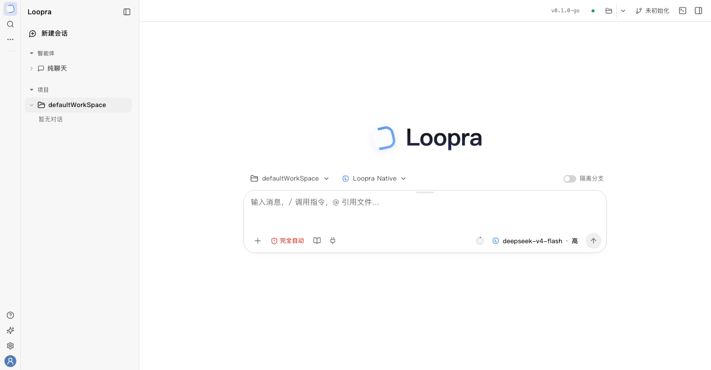

<p align="center">
  
</p>

<h1 align="center">Loopra</h1>

<p align="center">
  <strong>本地代码库的 AI 编码中枢</strong><br/>
  让 AI 在你的仓库里持续推理、执行工具、接受审批并记住上下文。
</p>

<p align="center">
  <a href="https://loopra.cn"></a>
  <a href="https://github.com/ezdemo/loopra-release/releases/latest"></a>
  <a href="https://github.com/ezdemo/loopra/actions/workflows/backend.yml"></a>
  <a href="LICENSE"></a>
</p>

<p align="center">
  <a href="#highlights">Highlights</a> ·
  <a href="#install">Install</a> ·
  <a href="#quick-start">Quick Start</a> ·
  <a href="docs/USER_GUIDE.md">User Guide</a> ·
  <a href="#documentation">Docs</a>
</p>

---

<p align="center">
  
</p>

## Highlights

- **持续执行**：检索、编辑、运行命令、读取结果，然后继续推理，直到交付或需要你决策。
- **本地优先**：文件、命令和 Git 发生在本机；会话与配置保存在 `~/.loopra`。
- **可控自动化**：`free` / `approval` / `auto` 三档审批、工作区写入边界、隔离 Git worktree。
- **长任务续航**：JSONL 会话、上下文压缩、项目记忆、Goal / Checklist，重开还能接上。
- **开放扩展**：MCP、OpenAPI、连接器、技能和 JS/TS 插件接入同一条工具链。
- **多模型与多引擎**：Chat Completions / Responses / Anthropic；Loopra Native、Claude Code、Codex 或 Devin。
- **入口自由**：Web、桌面、终端、编辑器 ACP、移动端和飞书 Bot。

## Install

命令行：

```powershell
# Windows PowerShell
irm https://raw.githubusercontent.com/ezdemo/loopra-release/main/.release/setup.ps1 | iex
```

```bash
# macOS / Linux
curl -fsSL https://raw.githubusercontent.com/ezdemo/loopra-release/main/.release/setup.sh | bash
```

桌面端：

```powershell
# Windows PowerShell
irm https://raw.githubusercontent.com/ezdemo/loopra-release/main/.release/setup-gui.ps1 | iex
```

```bash
# macOS / Linux
curl -fsSL https://raw.githubusercontent.com/ezdemo/loopra-release/main/.release/setup-gui.sh | bash
```

<details>
<summary>国内镜像与指定版本</summary>

```powershell
# Windows PowerShell
irm https://raw.githubusercontent.com/ezdemo/loopra-release/main/.release/setup-mirror.ps1 | iex
```

```bash
# macOS / Linux
curl -fsSL https://raw.githubusercontent.com/ezdemo/loopra-release/main/.release/setup-mirror.sh | bash
```

设置 `LOOPRA_VERSION=v26.10.2901` 安装指定版本；设置 `LOOPRA_MIRROR` 指定镜像。完整选项见[安装说明](docs/USER_GUIDE.md#安装)。

</details>

## Quick Start

```bash
loopra            # 打开 Web 工作台
loopra web 4567   # 固定端口
loopra tui        # 在当前目录打开终端会话
loopra acp        # 作为 ACP Agent 接入编辑器
```

首次启动后，在工作台「设置 → 模型供应商」配置模型渠道。浏览器和桌面窗口共享同一个工作台进程；`loopra tui` 会拉起独立的 `loopra acp` 会话，并沿用 `~/.loopra` 配置。

```text
你的入口：Web / Desktop / Terminal / Editor / Mobile / Feishu
                         ↓
                 Loopra 本地运行时
                         ↓
          模型 × 工具 × 审批 × 记忆 × 项目
```

## Use It Your Way

| 场景 | 入口 |
|---|---|
| 完整项目管理、聊天、Git、文件、插件 | `loopra` / 桌面端 |
| 留在终端和当前项目目录 | `loopra tui` |
| 从编辑器调用 Loopra Native | `loopra acp` |
| 手机远程连接 | [Loopra Mobile](docs/USER_GUIDE.md#loopra-mobile) |
| 飞书单聊 / 群聊 | [飞书 Bot](docs/USER_GUIDE.md#飞书-bot) |

## Documentation

| 文档 | 内容 |
|---|---|
| [完整使用指南](docs/USER_GUIDE.md) | 安装、模型、工具、插件、MCP、协作、审批、配置和开发 |
| [架构指南](docs/ARCHITECTURE.md) | 目录职责、依赖装配、配置加载和请求链路 |
| [插件文档](docs/PLUGIN.md) | JS/TS 插件、工具、钩子、页面后端和 GitHub 插件源 |
| [API 契约](docs/API_CONTRACT.md) | REST 路径、鉴权、响应形状和连接器接口 |
| [移动端文档](docs/MOBILE.md) | Android / iOS、远程中继和协议互操作 |
| [上下文管理](docs/CONTEXT_COMPACTION.md) | 循环内压缩、工具结果取回和前缀缓存 |

## License

[MIT](LICENSE) © 2026 Sorghum
