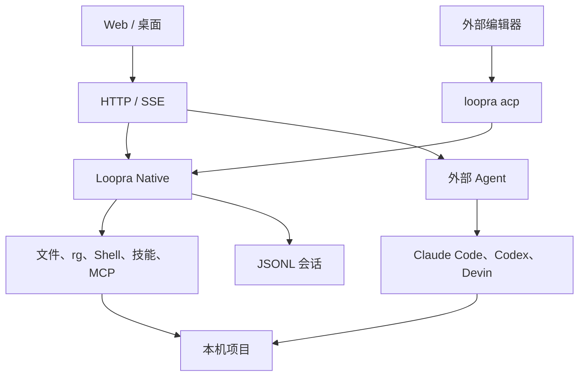

<p align="center">
  
</p>

<h1 align="center">Loopra</h1>

<p align="center">
  <strong>本地代码库的 AI 编码中枢</strong><br/>
  推理、执行、审批、记忆，一次闭环。
</p>

<p align="center">
  <a href="https://loopra.cn"></a>
  <a href="https://github.com/ezdemo/loopra-release/releases/latest"></a>
  <a href="https://github.com/ezdemo/loopra/actions/workflows/backend.yml"></a>
  <a href="LICENSE"></a>
</p>

<p align="center">
  Web · Desktop · Terminal · Mobile · Editor ACP · Feishu Bot
</p>

<p align="center">
  <a href="#快速开始">快速开始</a>
  &nbsp;·&nbsp;
  <a href="#能力全景">能力全景</a>
  &nbsp;·&nbsp;
  <a href="#它适合干什么">场景</a>
  &nbsp;·&nbsp;
  <a href="#架构">架构</a>
  &nbsp;·&nbsp;
  <a href="#工具与扩展">工具生态</a>
  &nbsp;·&nbsp;
  <a href="#配置">配置</a>
  &nbsp;·&nbsp;
  <a href="#文档">文档</a>
</p>

---

大多数 AI 编码工具停在“回答”。Loopra 继续往前一步：它在你的仓库里检索、编辑、运行命令、调用 MCP 和插件，把执行结果送回推理循环；遇到风险动作，它停下来等你批准；任务结束后，会话、记忆和审计记录仍然保留。

一句话：你定义目标，Loopra 组织模型、工具和上下文，把过程变成可观察、可接管、可恢复的交付。

```text
目标 → 推理 → 行动 → 观察 → 修正 → 交付
          ↺ 根据执行结果持续修正
```

它与旧版 Java Loopra 读写同一套 `~/.loopra` 配置和 JSONL 会话，已有数据可以直接接着用。新建会话默认使用 Loopra Native；也可以改接 Claude Code、Codex 或 Devin。外部引擎的能力取决于各自适配器，需要在后端所在机器上安装依赖并完成认证。下文的内置工具、模型渠道和审批规则适用于 Loopra Native。

## 为什么是 Loopra

| 维度 | Loopra 的打法 |
|---|---|
| **本地执行** | 文件、命令、Git 和系统目录操作发生在后端所在机器；业务配置与会话落在 `~/.loopra`。 |
| **可控自动化** | `free` / `approval` / `auto` 三档审批，配合工作区写入限制、受限路径和隔离工作树。 |
| **持续上下文** | JSONL 会话、循环内压缩、Goal / Checklist、全局与项目记忆，让长任务不靠一次性提示词硬撑。 |
| **开放生态** | 多模型渠道、MCP、OpenAPI、连接器、技能、JS/TS 插件，能力可以一路接到真实业务系统。 |
| **多端入口** | Web、桌面、终端、编辑器 ACP、移动端和飞书 Bot，共用同一套本地 Agent 能力。 |
| **引擎自由** | Loopra Native 之外，还能把 Claude Code、Codex 或 Devin 接进同一个工作台。 |

## 快速开始

三分钟进场：**安装 → 启动 → 配模型**。按入口选择命令行或桌面端；浏览器、原生窗口和终端共享同一个本地 Agent Runtime。从源码运行见 [从源码开发](#从源码开发)。

### 安装

安装包发布在 [Releases](https://github.com/ezdemo/loopra-release/releases/latest)。命令行和桌面端分开安装。

#### 命令行

安装后的命令是 `loopra`。

Windows PowerShell：

```powershell
irm https://raw.githubusercontent.com/ezdemo/loopra-release/main/.release/setup.ps1 | iex
```

macOS / Linux：

```bash
curl -fsSL https://raw.githubusercontent.com/ezdemo/loopra-release/main/.release/setup.sh | bash
```

#### 桌面端

用原生窗口打开同一套工作台。

Windows PowerShell：

```powershell
irm https://raw.githubusercontent.com/ezdemo/loopra-release/main/.release/setup-gui.ps1 | iex
```

macOS / Linux：

```bash
curl -fsSL https://raw.githubusercontent.com/ezdemo/loopra-release/main/.release/setup-gui.sh | bash
```

命令行装到 `~/.loopra/bin`（Windows 为 `%LOCALAPPDATA%\Loopra\bin`）。macOS 桌面端解压到 `~/Applications/Loopra.app`。

<details>
<summary>国内网络、指定镜像与指定版本</summary>

国内网络使用镜像脚本。未设置 `LOOPRA_MIRROR` 时，直连脚本走 GitHub 官方源，镜像脚本默认使用 `https://gh-proxy.org/`。所有安装脚本都接受 `LOOPRA_MIRROR`，用来指定镜像；桌面端的下载源列表可以先测速再挑选。

`LOOPRA_VERSION=v26.10.2901` 安装该版本。不设置时安装最新正式版。

命令行镜像，Windows PowerShell：

```powershell
irm https://raw.githubusercontent.com/ezdemo/loopra-release/main/.release/setup-mirror.ps1 | iex
```

命令行镜像，macOS / Linux：

```bash
curl -fsSL https://raw.githubusercontent.com/ezdemo/loopra-release/main/.release/setup-mirror.sh | bash
```

桌面端镜像，Windows PowerShell：

```powershell
irm https://raw.githubusercontent.com/ezdemo/loopra-release/main/.release/setup-gui-mirror.ps1 | iex
```

桌面端镜像，macOS / Linux：

```bash
curl -fsSL https://raw.githubusercontent.com/ezdemo/loopra-release/main/.release/setup-gui-mirror.sh | bash
```

指定镜像源。下面的例子把官方脚本配到 `gh-proxy.org`。

Windows PowerShell：

```powershell
$env:LOOPRA_MIRROR='https://gh-proxy.org/'; irm https://gh-proxy.org/https://raw.githubusercontent.com/ezdemo/loopra-release/main/.release/setup.ps1 | iex
```

macOS / Linux：

```bash
export LOOPRA_MIRROR='https://gh-proxy.org/'; curl -fsSL https://gh-proxy.org/https://raw.githubusercontent.com/ezdemo/loopra-release/main/.release/setup.sh | bash
```

</details>

### 启动

```bash
loopra            # 与 loopra web 相同，由系统分配空闲端口
loopra web 4567   # 固定端口
loopra web 0      # 同样由系统分配端口
loopra acp        # 在标准输入输出上提供 ACP，不启动网页
loopra tui        # 在当前目录打开终端聊天，不启动网页
```

`loopra web`（包括默认启动）会在控制台打印本地访问地址和本次启动的访问密钥。从该链接进入即完成校验；页面上的 API 请求携带 `X-Loopra-Key`。静态页面不校验密钥。未设置 `LOOPRA_ACCESS_KEY` 时，每次重启都会更换密钥。

首次启动会在 `~/.loopra/config.json` 写入默认配置。目录里已有 Loopra 配置时直接沿用。`LOOPRA_HOME` 可以把数据目录改到别处。

### 终端聊天

在项目目录里运行 `loopra tui`，直接在终端里开一个 Loopra 会话：不启动网页或 HTTP 服务，工作目录就是当前目录，模型渠道与权限配置沿用 `~/.loopra/config.json`。

Windows、macOS 和 Linux 的 amd64/arm64 命令行构建（包括普通 `go build` 和 IDE 构建）默认内嵌 MIT 许可的 [micro-acp](https://github.com/BrokkAi/micro-acp) v0.8.1 终端客户端。`loopra tui` 会从本机可执行文件解包启动客户端，由它通过标准输入输出连接同一可执行文件启动的 `loopra acp`。不用另装或下载客户端。客户端自己的会话状态放在 `$LOOPRA_HOME/micro-acp`（默认 `~/.loopra/micro-acp`）。

回车发送，`Alt+Enter` 或 `Ctrl+J` 换行，`/` 打开内置菜单；回复进行中按 Ctrl+C 停止本轮，输入为空时按 Ctrl+D 退出。micro-acp 自带本地会话列表。

其他平台（例如 Linux s390x）不内嵌客户端，`loopra tui` 会从 `PATH` 查找 `micro-acp`。`loopra web` 与 `loopra acp` 不受影响。

### 配置模型

使用 Loopra Native 时，在设置页维护模型渠道并保存。直接编辑 `~/.loopra/config.json` 后需要重启，服务才会重新加载。每个渠道独立维护 API 地址、密钥、协议和模型能力。

`apiProtocol` 支持 `chat_completions`、`responses` 和 `anthropic`。`specialCompatibility` 默认为空，可选 `opencode`，由兼容逻辑携带稳定的 `x-opencode-session` 会话路由头。

```json
{
  "model": "deepseek-v4-flash",
  "modelChannelId": "default",
  "modelChannels": [
    {
      "id": "default",
      "name": "Default",
      "baseUrl": "https://api.deepseek.com/v1",
      "apiKey": "sk-your-api-key",
      "apiProtocol": "chat_completions",
      "specialCompatibility": "",
      "models": [
        {
          "name": "deepseek-v4-flash",
          "contextTokens": -1,
          "maxTokens": 32768,
          "imageInput": false
        }
      ]
    }
  ],
  "workspaceDir": "/path/to/your/project"
}
```

`models` 兼容旧版字符串数组。每个模型条目还可以配置 `displayName`、`contextTokens`、`maxTokens`、`imageInput`、`reasoningEfforts` 和 `price`。`maxTokens` 是该模型单次请求的最大输出 token 数，包含推理 token；Chat Completions 映射为 `max_tokens`，Responses 映射为 `max_output_tokens`。未配置或小于等于 `0` 时使用 32768。`contextTokens` 为 `-1` 表示上下文窗口未知。

在界面上配置：设置 → 模型供应商 → 编辑模型 → 打开“配置推理强度”开关 → 勾选预设或填写自定义取值 → 应用更改 → 保存渠道。

`reasoningEfforts` 限定该模型可选的推理强度，按配置顺序展示并原样上行（含大小写与自定义取值，如 `Turbo`）。缺省（不配置）沿用内置目录 `none`、`minimal`、`low`、`medium`、`high`、`xhigh`、`max`；配置为空数组 `[]` 表示该模型不发送推理强度参数。保留值 `default` 属于 Fusion 执行强度，不能出现在模型目录里。会话强度超出目录时：显式请求被拒绝，已保存的失效值依次回退到全局默认和目录首项。未配置目录的模型保留历史兼容行为：上行前小写化，Responses 协议把 `max` 折叠为 `high`，Anthropic 不发送强度字段。

全局默认模型之外，每个会话可以单独选择模型、渠道和推理强度。选择写在服务端会话元数据里，重开或切换会话时恢复。首页当前的 Agent，以及每个 Agent 最近一次明确选择的模型、权限和推理强度，记在 `~/.loopra/agent-preferences.json`。新会话继承该 Agent 的上次配置，已有会话保留自己的设置。

完整字段见 [配置](#配置)。

## 能力全景

| 能力 | 杀伤力 |
|---|---|
| **持续推理内核** | 流式输出推理、工具调用和执行反馈；读到结果后继续下一轮，直到交付、取消或需要你决策。 |
| **长任务续航** | JSONL 持久化、循环内压缩、会话级模型、项目记忆、Goal / Checklist，重开后还能接上。 |
| **多模型自由** | Chat Completions、OpenAI Responses、Anthropic Messages 和 OpenCode 兼容网关；模型、渠道、推理强度可到会话级切换。 |
| **工具即战斗力** | 文件读写、内置 `rg`、系统 shell、联网查询、技能、MCP、OpenAPI、连接器和插件，统一纳入审批与权限边界。 |
| **多代理编排** | `explore` / `implement` / `test` / `review` / `plan` 独立上下文分工；Fusion 把主代理决策与边缘执行串起来。 |
| **人工控制点** | `free` / `approval` / `auto` 三档审批，工具模型预审；无法自动放行时转人工，边界清楚。 |
| **项目级工作台** | 项目、会话、聊天、模型、文件预览、Git、需求、定时任务和终端在同一套 React 界面里。 |
| **隔离交付** | 会话可切到独立 Git 工作树执行；分支、差异、提交和环境信息在同一个面板里收口。 |
| **引擎可替换** | 默认 Loopra Native，也能把 Claude Code、Codex 或 Devin 接进来，用同一个工作台观察和管理。 |
| **全端触达** | Web、桌面、TUI、ACP 编辑器、Android / iOS、飞书 Bot：同一套本地能力，不锁死入口。 |

## 它适合干什么

| 场景 | 打开方式 |
|---|---|
| **改造真实仓库** | 让探索子代理先读代码，主代理定方案，实现与验证在隔离工作树里完成。 |
| **跨项目排障** | 长期关联多个项目，配合 `rg`、日志读取、shell 和联网检索，把线索收进同一条会话。 |
| **接业务系统** | 用连接器、MCP 或 OpenAPI 把 Notion、Gmail、钉钉、内部 API 等能力接进工具调用。 |
| **跑长期需求** | 用需求看板、评论、执行记录和定时调度管理任务，按需求配置模型与审批。 |
| **扩展自己的 Agent** | 写 JS/TS 插件注入工具、钩子和右侧面板；或发布 Loopra 工具给其它 MCP 客户端。 |
| **在团队入口使用** | 通过飞书 Bot 把项目会话带进单聊和群聊，审批仍回到工作台确认。 |

## 架构

Loopra 的核心不是网页，而是一个本地 Agent Runtime：工作台通过 HTTP / SSE 进入进程；Loopra Native 在进程内完成推理、工具调用、审批和持久化；选择外部引擎时，同一进程以 ACP v1 stdio 客户端驱动本机适配器。反过来，`loopra acp` 也能把 Loopra 自己暴露给外部编辑器——这条路径不启动网页。



文件、命令和 Git 都发生在运行后端的那台机器上。会话和业务配置落在 `~/.loopra`。

`cmd/looprax` 是产品入口。依赖在 `internal/bootstrap` 集中注册，Controller 和 Service 不从全局容器查找对象。装配、配置加载和请求链路见 [架构指南](docs/ARCHITECTURE.md)。

```text
loopra/
├── cmd/looprax/            # Web 与 ACP 入口
├── cmd/looprax-desktop/    # 启动 API 并打开桌面窗口
├── internal/               # 应用本体
│   ├── bootstrap/          # 组合根与 HTTP 生命周期
│   ├── spring/             # 构造器注入的 IoC 容器
│   ├── controller/         # 路由、聊天、MCP、Git、需求
│   ├── service/            # 智能体、工具、审批、会话、ACP
│   ├── repository/         # config.json 与 JSON 文件
│   ├── model/              # 与 Loopra 兼容的配置和实体
│   └── infrastructure/     # 日志、路径、Git、内置 ripgrep
├── adk/                    # 模型协议适配与 JSONL 会话
├── web/                    # React 工作台
├── manifest/config/        # 进程配置 config.yaml
├── docs/                   # 架构、工具与 API 契约
├── scripts/                # 多平台打包
└── .github/                # 后端测试
```

| 层 | 技术 |
|---|---|
| Agent Runtime | Go、构造器注入、持续推理循环、工具编排、审批链 |
| API / 流 | HTTP、SSE、访问密钥、工作区上下文 |
| 工作台 | React 18、TypeScript、Vite、NextUI、Tailwind CSS、Monaco |
| 桌面 / 终端 / 移动 | 原生窗口与托盘、内嵌 micro-acp TUI、Tauri v2 / Android 客户端 |
| 协议 | MCP、OpenAPI、ACP、Chat Completions、Responses、Anthropic Messages、OpenCode 兼容网关 |
| 持久化 | JSONL 会话与审计事件、`~/.loopra` JSON 配置、项目 Markdown |

## 工具与扩展

Loopra 默认把编码 Agent 最需要的手脚装好：文件读写、代码检索、系统 shell、联网查询、子代理和技能。真正的上限来自开放生态——MCP、OpenAPI、连接器和 JS/TS 插件都能进入同一条工具链，并统一接受审批、工作区边界和会话记录约束。

AI 可以在回复正文中直接展示图片，例如 ``。支持本地绝对路径、基于会话工作目录的相对路径和 HTTP/HTTPS 图片，点击可放大。本地图片支持 PNG、JPEG、GIF、WebP、BMP、AVIF，单张不超过 5 MiB；历史会话引用原文件，需保留文件供后续查看。图片展示无需模型具备视觉输入能力。

原生 Agent 的工具在工具管理里启用或禁用，自定义工具可以指定只读或写入。项目内检索统一走内置 `rg`，二进制按目标平台随程序提供，无需另行安装 ripgrep。参数、示例和更新方式见 [rg 工具说明](docs/RG_TOOL.md)。

| 分类 | 覆盖场景 |
|---|---|
| 文件与代码检索 | `read`、`write`、`edit`、`rg` |
| 命令与网络 | 当前系统 shell（Windows 为 `powershell` 或 `CMD`，其他系统为 `bash` 或 `sh`）及其 `_start` / `_wait` / `_stdin` / `_stop`；`web` 的 `search`、`code`、`fetch` |
| 任务协作 | `sub_agent`、`ask_choice`；需求会话另有 `finish_requirement`、`reply_requirement_comment` |
| 技能 | `skillread`、`skilllist`、`skillsearch`、`skillrefresh` |
| 外部工具 | `tool_search`、`call_tool` 发现并调用 MCP 工具 |

`rg` 用 `content` 搜索内容，用 `files` 枚举路径，用 `files_with_matches` 按内容筛选文件。查看目录结构时使用当前系统 shell。大批量统计优先用 `rg`。

`read` 支持按行跳读：`offset` 是起始行号（1 起，负数从末尾倒数），`max_line` 是最多返回的行数；返回包含行号的文本和 `start_line`、`end_line`、`total_lines`、`truncated`，可以接着上一次的结果继续读。配合 `rg` 输出的行号即可只看感兴趣的片段。

`read`、`rg`、`read_image` 和命令工具都不受项目范围限制：它们可以读取依赖、日志、配置和项目外的任何文件，方便查看上下文。

`write` 与 `edit` 默认也可以直接使用项目外的绝对路径。在设置 → 工具开启「限制工具工作区」后，它们只能写入主项目、长期关联的副项目和本轮临时关联项目。相对路径以主项目为准，操作副项目时使用绝对路径。命令工具不受该开关影响：它本身就能访问任意路径，单独限制 `cwd` 并不增加隔离。

命令工具支持 `cwd`、`max_char` 和 `timeout_ms`（毫秒）。一次性命令默认最多返回 64000 个字符、超时 120000 毫秒，`timeout_ms` 上限 3600000。交互会话先调用 `_start`，再用 `_wait`、`_stdin` 和 `_stop` 管理同一进程。

原生主会话的一次性命令、`rg`、`sub_agent` 和内置 `web` 支持半异步执行：默认同步等待 5 秒，超过后返回 `running` 与 `call_id`，Agent 可继续独立工作。服务端通过工具元数据声明能力，插件也可设置 `async: true`；通用包装器自动提供 `yield_after_ms` 调整等待窗口（0 使用默认值，上限 60000），不会改变工具本身的执行期限。需要结果才能继续时，调用 `tool_result(call_id, timeout_ms)`；未被主动取得的最终结果会自动送回模型循环，界面更新原工具条目。取消当前轮次会终止并回收这些执行。MCP 导出及未声明支持的工具保持同步；后台执行不跨进程重启恢复。详见[半异步工具契约](docs/ASYNC_TOOLS.md)。

`web` 用一个入口完成联网：`action=search` 做网页搜索，`action=code` 检索库、SDK 和 API 文档，`action=fetch` 读取 URL 并转成 Markdown、纯文本或 HTML。

使用 `web` 的回复会在「用时」旁显示网页来源数量，点击可查看并打开本轮搜索或读取的页面。

### 技能

Loopra 随程序提供只读的内置 `SelfSkill`（`@builtin-skills/self-skill`），介绍能力入口、技能发现与加载、MCP / OpenAPI 接入和能力缺失排查。系统提示会引导 Agent 在首次处理任务前通过 `skillread` 读取。

技能还从这些目录挂载，同名技能用完整标识区分：

| 来源 | 位置 | 标识 |
|---|---|---|
| 内置 | 程序内嵌，只读 | `@builtin-skills/self-skill` |
| 用户 | `~/.loopra/skills/<skill-name>/SKILL.md` | `@loopra-skills/...` |
| 通用 | `~/.agents/skills/<skill-name>/SKILL.md` | `@agents-skills/...` |
| 项目 | `<项目>/.loopra/skills/<skill-name>/SKILL.md` | `@project-skills/...` |

`~/.agents/skills` 默认随启动扫描，无需另行配置；Windows 对应 `%USERPROFILE%\.agents\skills`。技能目录支持普通文件夹、符号链接和 Windows 目录联接，配套资源以链接指向的技能目录为范围。目录可以在启动后创建，调用 `skillrefresh` 即可发现。通用技能目录可用 `LOOPRA_AGENTS_SKILLS_DIR` 覆盖。技能市场安装到 `~/.loopra/skills`。

### 插件

插件是 JavaScript 或 TypeScript 模块，运行时是 [moejs](https://github.com/MoeForge/moejs)（Apache-2.0）。从侧栏「技能与插件」点击「添加 → 安装插件」填写来源，例如 `left-pad@1.3.0`、`@scope/pkg`、`https://github.com/owner/repo`，或本地目录与 `.js` / `.ts` 文件。安装位置是 `~/.loopra/plugins/packages/<id>`，清单是 `~/.loopra/plugins/installed.json`。插件页面可以通过 `loopra.request()` 调用自己的 `onRequest` 后端，接收当前项目、会话和文件上下文。写法、钩子、页面后端、`fetch` 和 `node:fs` 见 [docs/PLUGIN.md](docs/PLUGIN.md)。

入口优先读 package.json 的 `loopra`（字符串，或 `{ "plugin": "./plugin.ts" }`），然后是 `module`、`main`，再否则是 `plugin.ts`、`plugin.js`、`index.ts` 或 `index.js`。

侧栏「技能与插件」顶部提供「插件 / 技能」切换，默认选中「插件」。在「插件 → 发现」中可把公开 GitHub 仓库作为插件源，默认加入 [ezdemo/loopra-plugins](https://github.com/ezdemo/loopra-plugins)。可以添加、移除和切换源，浏览仓库里的插件后分别安装；「插件 → 我的内容」管理已安装插件，技能则在顶部切换后查看。源自动扫描每个插件目录的 `package.json` 和入口文件，无需索引；目录示例见 [examples/plugin-source](examples/plugin-source/)，规则和接口见 [GitHub 插件源](docs/PLUGIN.md#github-插件源)。

已安装的外部插件可在「我的内容」或「发现」中更新，沿原来源获取新版，保留配置、数据和启停状态，失败时保留旧版。更新成功会显示自动消失的顶部通知，不占列表位置；刷新列表不会更新插件。npm 更新解析 `latest`，GitHub 保留原 ref 和子目录，本地插件重新读取原路径，详见[更新与版本](docs/PLUGIN.md#更新与版本)。发现页也可直接卸载，安装、更新和卸载保留当前列表与滚动位置。纯聊天右侧栏支持「能力」和插件面板。多个插件的 `systemPrompt.append` 会依次累加；`meta.hookPriority` 为每个 Hook 指定整数优先级，数值小的先执行，默认 `0`，同级按安装顺序执行，详见[钩子](docs/PLUGIN.md#钩子)。

导出的函数会变成工具，公开名称是 `<插件 id>__<导出名>`：

```js
export function greet(args) {
  return { text: "hello " + (args.name || "world") };
}
```

也可以用清单分发：

```js
export function tools() {
  return [{
    name: "greet",
    description: "打招呼",
    readOnly: true,
    parameters: {
      type: "object",
      properties: { name: { type: "string", description: "名字" } },
      required: ["name"]
    }
  }];
}
export function call(input) {
  return { text: "hello " + (input.args.name || "world") };
}
```

也可以只导出钩子，或和工具写在同一个模块里。钩子按安装顺序串起来，前一个的返回值会交给下一个。某个插件抛错时跳过它，后面的继续执行。

- `turnBefore`：改用户消息、追加 `context`，或用 `cancel: true` 结束这一轮
- `systemPrompt`：返回 `text` 替换系统提示词，或用 `append` 追加
- `llmRequest`：改发给模型的消息、采样和工具列表。返回 `body` 时替换即将 POST 的 JSON，HTTP 仍由宿主发送
- `llmResponse`：改模型最终回复里的文本、推理和工具调用。已经流式显示的片段不会逐个改
- `toolBefore`：`allow` 可改参数，审批和路径检查仍然生效；`deny` 直接拒绝；`ask` 进入现有审批。用户批准后会再进一次，此时 `approved` 为 true
- `toolAfter`：改工具结果，或把失败写成说明
- `compact`：改压缩摘要。返回 `keep` 会把要留下的片段补进摘要，`drop: true` 丢掉这次摘要
- `turnAfter`：本轮结束时的清理。`status` 是 `completed`、`cancelled` 或 `error`，改不了已经发出的回复

这些函数的参数和返回值都是一个对象，可以是 async，宿主会等 Promise 完成。子代理走同一套钩子，并带上 `parentSessionId`。可以 `import` 相对路径、随包安装的依赖，以及 `node:fs`、`node:fs/promises`、`node:buffer`。`fetch` 使用 moejs 的 Web API，不按主机名拦截。`node:fs` 可以读写本机文件，不另加路径白名单；Windows 上系统盘挂在 `/`，`C:\Users\a\b.txt` 写成 `/Users/a/b.txt`。插件代码的 `import` 不能越出插件目录，`eval` 不可用。只读工具会自动放行，写入工具仍走审批。

### MCP

MCP 可为 Agent 注入额外能力。用户级配置在 `~/.loopra/mcp-servers.json`，项目级配置在 `<项目>/.loopra/mcp-servers.json`，只对当前项目生效。两种文件都支持标准的 `mcpServers` 对象，也兼容管理页使用的 `servers` 数组：

```json
{
  "mcpServers": {
    "project-tools": {
      "type": "stdio",
      "command": "node",
      "args": ["tools/server.js"],
      "env": {"PROJECT_ROOT": "."}
    }
  }
}
```

原生 Agent 通过固定的 `tool_search` 和 `call_tool` 使用 MCP。工具定义按需出现在搜索结果里，请求里的工具列表保持稳定。连接在实际检索或调用时建立，当前轮次内复用，轮次结束后关闭。检索方式见 [工具发现与动态调用](docs/TOOL_DISCOVERY.md)。

Loopra 也可以对外发布自己的工具。设置页进入「MCP 服务器 → 发布 Loopra 工具」。发布默认关闭，启用后使用 Streamable HTTP（默认 `/mcp`，也可切换 SSE）。选择「全部已启用」发布当前启用工具，选择「手动选择」时只发布白名单中的工具。配置保存在 `~/.loopra/mcp-server.json`。连接地址为当前 Web 服务地址加上 endpoint，例如 `http://127.0.0.1:8080/mcp`，请求需要 `X-Loopra-Key`。

同一设置页可以一键启动 Cloudflare Quick Tunnel。本机需要已安装 `cloudflared` 并加入 PATH，也可以在页面填写可执行文件路径。Quick Tunnel 生成临时公网地址，应用退出后失效；本地代理只转发已配置的 MCP endpoint。该能力适合开发和测试。Quick Tunnel 不支持 SSE，请将 MCP 传输方式设为 Streamable HTTP。

### 连接器

连接器把常用服务（高德地图、Notion、Gmail、钉钉等）包装成开箱即用的 MCP 能力，不需要手写 MCP 配置。侧栏进入「技能与插件 → 连接器」，按分类或搜索找到服务后点卡片上的 `+` 连接。

登录方式按服务而定：支持 OAuth 的服务（如 Notion、Gmail）一键跳转浏览器完成授权；其余服务粘贴令牌或应用凭据即可，公开服务（auth 为 none）直接连接。目录只收录可一键安装的 MCP 服务；钉钉等本地 stdio 服务需要对应运行环境（npx/uvx/python/docker），缺失时卡片会标出具体依赖。凭据保存在 `~/.loopra/connectors.json`，不会出现在对话或日志里。

连接后服务即作为 MCP 来源进入 Agent 的工具搜索，工具名以 `<连接器 id>/<工具>` 限定。已连接的连接器可在卡片上全局启停，也可以在输入框 `+` 菜单的「连接器」里按会话开关。任务需要某个尚未连接的服务时，Agent 会在输入框上方弹出连接卡片，在卡片里完成连接后同一轮继续执行；也可以直接对话让 Agent 启用、停用或断开连接器。「自定义连接器」区沿用现有 MCP 管理页。接口定义见 [API 契约](docs/API_CONTRACT.md)。

维护：内置目录是仓库根的 `connectors/` 数据包，编译期嵌入（不是 `~/.loopra` 的运行时凭据存储）。`catalog.json` 声明分类、参考来源（HowAI、dsh-mcp-center）和 `order` 展示顺序；`registry/<id>.json` 一个文件一个连接器，含 transport/auth 模板；`schema/connector.schema.json` 是描述符的 JSON Schema。新增连接器 = 加一个 registry 文件并把 id 插入 `order`，然后跑 `go test ./internal/service/connector` 校验全仓。完整字段规范见 [API 契约 §3.19](docs/API_CONTRACT.md)。

### Loopra Mobile

`mobile/` 提供基于 Tauri v2 的 Android / iOS 客户端。手机端采用独立的液态玻璃应用面板：中性底图、磨砂分组、悬浮底栏和聊天输入面板，核心聊天渲染复用 Loopra。通过自建 [alma-relay](https://github.com/yetone/alma-relay) 承载 Loopra 私有加密协议。桌面与 Web 在 **设置 → 连接与帮助 → 远程访问** 配置 HTTPS 中继和可选注册密钥，保存后显示 `loopra://` 配对链接与二维码，手机直接扫码连接。不再兼容 Alma 客户端协议。

手机直接复用原生 HTTP/SSE 接口，提供项目与会话切换、流式聊天、停止、工具审批、Agent 提问、折叠思考/工具/子代理和消息内文件差异；字号和主题独立设置。终端、完整编辑器、插件界面、历史回滚和桌面设置未移植。手机断线不取消后台 Agent，重连后读取现有历史和状态。停用保留设置，重置配对使旧二维码失效。

`mobile/android/` 还有一个原生 Jetpack Compose + Backdrop 液态玻璃客户端（`app.loopra.android`，无 WebView，纯 Kotlin OkHttp/JCA 传输，与 `loopra-relay` 协议互通），可与 Tauri 版并存安装，见 [mobile/android/README.md](mobile/android/README.md)。

默认关闭。`LOOPRA_ALMA_RELAY_URL`、`LOOPRA_ALMA_RELAY_KEY` 可以提供初始设置；页面保存的配置优先，继续保存在 Loopra 数据目录的 `alma-relay.json`。管理接口为 `/api/remote/relay`，注册密钥不回显。当前「中继已连接」不代表手机 WSS 已连接。

移动端开发、Android/iOS 构建见 [mobile/README.md](mobile/README.md)，协议和互操作测试见 [MOBILE.md](docs/MOBILE.md)。

### 上下文透镜

安装 [上下文透视插件](https://github.com/ezdemo/loopra-plugins/tree/main/plugins/context-lens) 后，右侧面板的「透镜」页签可只读查看 Loopra Native 每次模型请求发送前的实际上下文组成与原文。最近的请求快照会保存到本地，重启后仍可查看。没有快照的旧会话（含外部 ACP Agent）展示已保存的消息、思考和工具记录，并明确标为会话历史。分类用量标为文本估算，原始会话记录不变；当前插件不提供固定补充信息或折叠工具结果。插件可通过 `ui.panel` 声明同样的右侧页签，见 [插件文档](docs/PLUGIN.md#右侧面板)。

### OpenAPI 插件

从技能与插件 → 插件 → 发现安装 [OpenAPI 插件](https://github.com/ezdemo/loopra-plugins/tree/main/plugins/openapi)，然后在设置 → 工具与集成 → OpenAPI 添加 JSON / YAML 格式的 OpenAPI 3 或 Swagger 2 文档，配置服务地址、请求头以及 Bearer、Basic 或 API Key 认证。原有的 `~/.loopra/openapi-sources.json` 和文档缓存继续使用。

插件提供 `search_apis`、`get_api_detail`、`call_api`，在项目和纯聊天中都可用。先搜索接口，再读取参数详情，最后调用；实际调用经过现有工具审批。支持普通路径、查询、请求头参数与 JSON 请求体、本地 `$ref`；外部引用、表单和文件上传暂不支持。在技能与插件 → 插件 → 我的内容中停用 OpenAPI 后，其菜单和工具一起移除，接口源配置保留。

## 协作与审批

自动化不等于失控。Loopra 把长任务拆成可观察的执行链：主代理掌握目标与决策，子代理或 Fusion 执行具体调查、实现和验证；每一次写文件、跑命令或访问外部服务，都可以进入明确的审批边界。

### 子代理

子代理通过 `sub_agent` 派生。默认配置中，`explore`、`review` 和 `plan` 只读；`implement` 与 `test` 可按配置执行写操作。角色定义在 `~/.loopra/sub-agents.json`，可在智能体设置中调整启用状态、说明、工具范围和渠道模型。内置角色的正文在启动时还原，启用状态会保留。

每个子代理拥有独立推理上下文。事件写入父会话的 `.sub/<subSessionId>.jsonl`，并转发到父聊天流。子代理不能再派生子代理，也不能改写 Goal 或 Checklist。单次任务超时由 `subAgentTimeoutSec` 控制，默认 3600 秒。

项目会话可以开启 Fusion：输入栏「模型与推理设置 → 边缘」选择执行模型或「关闭」，会保存到服务端，供新的原生项目会话继承。已有会话保留各自的选择；纯聊天和外部 Agent 不受影响。首次使用时默认关闭。没有明确选择过的新会话跟随该默认，并在首次发送消息时把继承的值固定到会话 `.meta`；已有记录的旧会话保持关闭。开启 Fusion 后，可在同一菜单的「边缘推理」单独设置强度；「默认」使用执行模型自身的默认强度，不跟随主模型。开启后主代理继续负责澄清需求、定方向与最终交付；调查、实现或验证都通过 `fusion_delegate` 向同一个边缘会话交接，不需要选择角色；各次委派同步交接——调用会等待最终结果，执行代理的思考、正文、工具调用与审批和其他聊天内容一样显示；委派时长跟随父轮次取消，不受 `subAgentTimeoutSec` 限制。普通 `sub_agent` 仍按原有角色配置选模型，不走 Fusion。原生项目会话可用只读工具 `checklist_update` 维护本轮待办清单，通过输入框上方的「待办」按钮查看（记录在普通工具调用里，无额外事件或文件）；Fusion 模式下对需要实际改动或验证的任务，主代理先列出步骤和负责人，并把要交接的 Sidekick 步骤标为进行中后才能委派，每次清单更新只授权一次交接；简单问答和闲聊不需要清单。旧会话里的 `fusion_plan` 记录仅作历史回放还原清单，不再注册。设计决策始终留在主代理，执行模型沿用现有的工具审批与工作区限制。同一会话的多次委派交给同一个执行代理：它会保留此前成功交接的上下文（写在 `{会话}.sub/.fusion-context.json` 私有检查点，重启与后续委派继续有效；失败或取消的交接不会写入），因此主代理反馈修正时不必重发全部历史。更换模型、关闭再开启或撤回会话历史会重置上下文；工作区或关联项目变化时，不加载不匹配的检查点。执行过程可在父对话历史中查看，不出现在子代理列表，也不能直接向执行代理发消息。

### 任务进度与项目记忆

Loopra Agent 直接按任务和工具审批策略执行，不提供独立计划模式。外部 ACP Agent 若提供计划模式，输入框继续适配其配置选项与指令，并展示其计划进度。

会话 Goal 与 Checklist 保存在数据目录和项目的 `.loopra` 下，供界面展示长任务进度。项目说明可放在数据目录或项目根的 `loopra.md`，以及项目根的 `AGENTS.md`，启动会话时会并入系统提示。`/init` 会分析项目并生成 `loopra.md`。

在 **设置 → 智能体 → 记忆** 中管理长期记忆，可搜索、添加、查看、编辑和删除。全局记忆跨项目共享，适合个人偏好和本机环境（例如 Java 安装方式、使用 nvm 管理 Node.js）；项目记忆按项目隔离，适合背景、约定和长期决策。纯聊天只使用全局记忆。

全局记忆存放在数据目录的 `memories.json`，项目记忆存放在项目根目录的 `.loopra/memory/memories.json`。隔离工作树沿用主项目的记忆；旧版数据目录中的项目记忆在首次读取时迁移，旧文件保留作备份，新位置已有数据时优先使用新文件。

系统提示词引导内置 Agent 在新会话先用 `memory_search(action="list")` 查看全局和当前项目的记忆目录，目录仅包含 ID 和标题，再根据对话需要用 `action="read"`、scope、id 读取具体正文。目录较多时可分页，或用 `action="search"`、query 搜索。目录直接从已有记录生成，保存、改名和删除都会反映到目录中，无需另维护索引文件。记忆正文不自动加载；通过 `memory` 保存、更新或删除可靠信息，也可以直接告诉它“记住这个偏好”。一条记忆一个主题，标题具体说明用途，环境信息使用前核实。无需额外模型配置。外部 ACP Agent 的提示词和自主记忆仍由对应 Agent 管理。

### 审批

`hitl` 支持三种执行模式：

| 模式 | 行为 |
|---|---|
| `free` | 跳过工具审批链。工具自身的路径与参数校验仍然生效。 |
| `approval` | 自动放行只读工具、项目内文件写入和可识别的项目内命令；其余调用转人工审批。 |
| `auto` | 先应用与 `approval` 相同的规则，再使用已配置的工具模型审核剩余调用；未配置、未批准或审核失败时转人工。 |

工具模型（`toolModel` / `toolModelChannelId`）用于生成会话标题，也用于 `auto` 模式下的命令校验。`blockedPaths` 中的路径一律转人工。这是应用层审核，工具自身的路径与参数校验仍然生效，它不替代操作系统沙箱。旧配置里的布尔值会迁移：`true` 视为 `approval`，`false` 视为 `free`。

## 使用

入口不止一个，但核心是同一个：浏览器工作台负责完整管理，桌面端提供原生窗口和托盘，终端适合留在项目目录里，ACP 把能力交给编辑器，移动端和飞书 Bot 把会话带离工位。

### 工作台

`loopra` 不写子命令时启动 Web，`loopra web [port]` 与之相同。`loopra-desktop` 启动同一服务并打开工作台窗口，地址里自动带上密钥。文件、命令、Git 和系统目录操作发生在后端所在机器。

工作台语言在「设置 → 偏好设置 → 通用 → 语言」中切换，支持简体中文和 English；切换后立即生效，不需要重启。当前主要工作台界面（导航、侧栏、头部、输入区、聊天操作、搜索和通用设置）会跟随语言切换，部分深层管理页、后端返回的错误或 Agent 自定义内容仍可能保留原文。

桌面端点击关闭按钮会隐藏工作台，后台服务和正在执行的任务继续运行。Windows 图标位于任务栏通知区域（可能收在隐藏图标中），macOS 位于顶部菜单栏，Linux 位于桌面面板的系统托盘。通过图标菜单的“打开 Loopra”恢复窗口，“退出”完全关闭应用；再次启动桌面端也会唤回已有窗口。macOS 的 Dock 图标和 `Cmd+Q` 仍可使用。

Linux 托盘需要 `libayatana-appindicator3`（部分发行版包名为 `libayatana-appindicator3-1`）及桌面环境的 AppIndicator 支持；GNOME 通常需要启用 AppIndicator 扩展。托盘无法创建或注册时，关闭按钮保持退出行为；Windows 关闭窗口前还会检查图标仍然存在。

工作区中的「纯聊天」支持 `web` 联网查询、已安装技能，以及一次性命令和交互终端。输入框可以选择技能或使用 `/skills`、`/terminal`；终端默认工作目录为系统临时目录。提示词禁止操作普通目录与文件，允许系统临时目录、技能目录和配套资源，产物写入临时目录，工具沿用现有审批。纯聊天不关联项目，右侧栏显示能力和插件面板，会话仍独立持久化。

侧栏「智能体」区还可以在纯聊天之外新建**自定义智能体**：为它命名、写一段角色设定，可选绑定一个项目并限制其可用工具与技能。不绑定项目的智能体表现与纯聊天一致；绑定后则拥有该项目的文件、Git、隔离分支与关联项目等完整能力。自定义智能体使用内置 Loopra Native 引擎，定义与会话都保存在本地，接口见 [API 契约](docs/API_CONTRACT.md)。

控制台日志是带颜色的固定列。`NO_COLOR` 或 `FORCE_COLOR=0` 关闭颜色。收到中断或终止信号后，应用停止后台任务并关闭 HTTP 服务。

### 聊天命令

下面是 Loopra Native 的常用命令。完整列表以界面命令菜单和 `/help` 为准。外部 ACP Agent 的命令由各自引擎提供。

| 命令 | 用途 |
|---|---|
| `/help` | 显示可用命令。 |
| `/new`、`/clear` | 回到当前工作区的新会话。 |
| `/sessions` | 浏览、导出或清理历史会话。 |
| `/export` | 下载当前会话的纯文本记录。 |
| `/compact` | 折叠历史上下文。 |
| `/goal ...` | 查看或管理当前会话 Goal。 |
| `/hitl`、`/agree`、`/deny` | 切换审批模式，或处理待审批工具调用。 |
| `/continue` | 继续当前任务。 |
| `/init` | 分析项目并生成 `loopra.md`。 |
| `/skills` | 为这条消息附加技能。 |
| `/plugin` | 打开技能与插件中的插件页，安装 npm 或 GitHub 插件。 |
| `/terminal` | 在右栏打开命令面板。 |

### 输入

输入框底部的常用要求保存在 `~/.loopra/prompt-presets.json`。点击预设会追加到当前输入。`@` 引用工作区文件，`Shift + Enter` 换行。过大的粘贴会先存到项目的 `.loopra/paste/`，再让 Agent 用 `read` 按需读取。生成期间可以停止当前回复。

在单个项目的管理弹窗中，可手动输入目录路径、选择文件夹，或点击路径框右侧的「选择已有项目」，在独立弹窗中勾选要关联的其它项目。三种入口等价：无论输入路径、选择文件夹还是勾选已有项目，都只把该目录写入副项目列表，不会在项目列表中新建项目，也不依赖项目记录。因此从项目列表删除某个项目后，其它项目的关联仍然有效，显示的是目录名与路径。主弹窗仅显示已关联目录，点击条目右侧的删除图标可解除关联。当前项目与会话保持不变，旧版本保存的项目标识关联会在下一轮按目录继续生效，并在删除该项目时自动改写为目录关联；关联或取消关联后自动保存，用于该项目的所有会话，从下一轮生效。主项目与副项目的目录会写入系统提示词，默认命令目录仍是主项目。输入框中的「关联项目」继续用于临时选择；长期关联与临时关联合计最多 8 个，并且不会递归关联副项目自己的副项目。解除关联后，开启工作区写入限制时会同步收回对应目录的写入权限。

### 飞书 Bot

左侧「定时任务」下方的 **Bot** 页面支持扫码添加飞书机器人、修改名称、启停、重新授权和删除。扫码确认后自动创建 `Bot-飞书-xxxxx` 项目，可以在项目列表重命名；删除 Bot 会断开连接，但保留项目和历史会话。

在 Bot 管理中点击「关联项目」，使用已有的项目关联功能，让同一个 Agent 在一轮任务里访问多个代码库。每个飞书单聊或群聊分别绑定一个 Loopra 会话，持续复用上下文。当前使用 Loopra Native，模型与工具权限沿用工作台设置，需审批的工具在工作台确认。

默认仅扫码用户可以使用；可在「访问权限」添加其他用户的 Open ID。群聊还需加入允许的群聊 ID，并 @Bot。当前支持文字输入，回复由飞书原生渲染 Markdown，长回复自动分段并保留代码块格式。图片和附件输入会提示改用文字；执行中再次发送消息会收到忙碌提示。需要保持本地 Loopra 运行并能连接飞书，才能接收消息。

连接凭证保存在应用数据目录的 `bots.json`，不返回给浏览器。Bot 工作目录位于同目录下的 `bot-projects/{botId}`。

### ACP

Loopra 可以作为 ACP Agent 供外部编辑器连接。这条命令只占用标准输入输出，不启动 HTTP 服务，日志写到 stderr：

```bash
loopra acp
```

工作台里的 Loopra Native 会话不会拉起这条命令。

在工作台中选择外部引擎时，本进程以 ACP v1 stdio 客户端驱动本机适配器。需要已安装的 Node.js，以及对应适配器：`@agentclientprotocol/claude-agent-acp`、`@agentclientprotocol/codex-acp`；Devin 使用独立安装的 `devin` CLI，无需 Node 适配器。`GET /api/agent-engines` 会报告每个引擎的可用性与缺失原因。下面的环境变量可覆盖自动探测：

| 环境变量 | 作用 |
|---|---|
| `LOOPRA_NODE_EXECUTABLE` | Node.js 可执行文件。 |
| `CLAUDE_CODE_EXECUTABLE` | Claude Code 可执行文件。 |
| `LOOPRA_CLAUDE_ACP_SCRIPT` | Claude ACP 适配脚本。 |
| `LOOPRA_CODEX_ACP_SCRIPT` | Codex ACP 适配脚本。 |
| `LOOPRA_DEVIN_EXECUTABLE` | Devin CLI 可执行文件。 |

启动外部 Agent 时会把 `127.0.0.1`、`localhost` 和 `::1` 合并进子进程的 `NO_PROXY`，避免继承来的 `HTTP(S)_PROXY` 把发往本机推理网关的请求转走。会话通过 `.meta` 的 `agentId` 绑定引擎，ACP 转录写入同一份 `.jsonl` / `.events`。任意回复都可以「继续到新会话」并换用其他引擎：跨引擎分支复制本地可见历史；转到外部引擎后，首轮把旧对话作为独立上下文块交接，用户消息原样发送。

### Java 兼容后端

设置 `LOOPRA_JAVA_BACKEND_URL` 后，全部 `/api` 与 `/mcp` 交给该服务，包括聊天、历史、权限与引擎管理；本进程的调度器不会启动，原生插件也不会加载。两边密钥不同时再设置 `LOOPRA_JAVA_BACKEND_KEY`。本进程自己的插件不依赖这个地址。

## 配置

业务配置在 `~/.loopra/config.json`。日常在设置页修改；直接改文件后需要重启才会重新加载。无法识别的字段会原样保留，以便和 Java 版 Loopra 来回使用。

| 字段 | 类型 | 默认值 | 说明 |
|---|---|---|---|
| `modelChannels` | array | 默认渠道 | API 地址、密钥、协议与模型条目。 |
| `modelChannelId` | string | `default` | 当前模型所属渠道 ID。 |
| `model` | string | `deepseek-v4-flash` | 当前模型名称。 |
| `imageUnderstandingModel` | string | `""` | 图片理解模型，需在模型条目中启用 `imageInput`。 |
| `imageUnderstandingModelChannelId` | string | `""` | 图片理解模型所在渠道 ID。 |
| `toolModel` | string | `""` | 用于生成会话标题和自动审批时的命令校验。 |
| `toolModelChannelId` | string | `""` | 工具模型所在渠道 ID。 |
| `workspaceDir` | string | 自动创建默认项目 | 当前项目目录。 |
| `reasoningEffort` | string | `high` | `none`、`minimal`、`low`、`medium`、`high`、`xhigh` 或 `max`；模型条目配置 `reasoningEfforts` 后取该模型目录内取值。 |
| `hitl` | string | `free` | `free`、`approval` 或 `auto`。 |
| `editMode` | string | `auto` | 编辑模式。 |
| `lang` | string | `ZH` | 界面语言，`ZH` 或 `EN`。 |
| `fastMode` | bool | `false` | 快速模式。 |
| `maxContextChars` | int | `200000` | 模型上下文容量未知时，用于估算压缩阈值。 |
| `keepTailChars` | int | `80000` | 旧版兼容字段；原生 Agent 用 `contextCompaction.retainEvents` 保留最近事件。 |
| `contextCompaction` | object | 自动开启 | 原生 Agent 循环内压缩、最近事件保留和稳定的工具结果裁剪；见[上下文管理](docs/CONTEXT_COMPACTION.md)。 |
| `toolTimeoutSec` | int | `360` | 单工具超时秒数。 |
| `subAgentTimeoutSec` | int | `3600` | 子代理完整任务超时秒数（Fusion 委派随父轮次取消，不适用）。 |
| `disabledTools` | string[] | `[]` | 禁用的工具名称。 |
| `toolsRestrictWorkspace` | bool | `false` | 开启后 `write`、`edit` 只能写入主项目、长期关联的副项目和本轮临时关联项目；`read`、`rg`、`read_image` 与命令工具不受影响。也可在设置 → 工具里切换。 |
| `blockedPaths` | string[] | `[]` | 受限路径列表。 |
| `worktreeBaseDir` | string | `~/.loopra/worktree` | 隔离分支模式的根目录。 |

旧配置中未设置工具模型时，会沿用已配置的命令校验模型及其渠道；两项都已设置时，以工具模型为准。

首次启动未指定 `workspaceDir` 时，会在数据目录旁创建 `defaultWorkSpace`，避免把启动目录意外当成项目根目录。

进程如何监听、页面放在哪里，由另一层设置决定。优先级为 **命令行参数 > 环境变量 > `manifest/config/config.yaml` > 内置默认值**。`LOOPRA_CONFIG` 或 `--config` 可指向其他进程配置。监听地址默认 `127.0.0.1`。加载规则见 [架构指南](docs/ARCHITECTURE.md#配置)。

| 设置 | 环境变量 | 说明 |
|---|---|---|
| 数据目录 | `LOOPRA_HOME` | 默认 `~/.loopra`。 |
| 端口 | `LOOPRA_PORT` | 未指定或为 `0` 时由系统分配空闲端口。 |
| 访问密钥 | `LOOPRA_ACCESS_KEY` | 缺省时每次启动随机生成。 |
| 前端目录 | `LOOPRA_STATIC_DIR` | 留空时用 `web/dist`，再是嵌进二进制的页面，最后才是 `<数据目录>/static`。 |
| 宠物目录 | `LOOPRA_PETS_DIR` | 默认 `~/.petdex/pets`。 |
| 调试日志 | `LOOPRA_DEBUG=1` | 默认只保留启动、对话、外部 Agent 和 API 错误。 |

## 从源码开发

改后端从 `internal/` 和 `adk/` 进入，改界面从 `web/` 进入。

| 依赖 | 版本 |
|---|---|
| Go | 1.27.3，以 `go.mod` 的 `go` 行为准 |
| Node.js | `^20.19.0` 或 `>=22.12.0` |
| pnpm | 8+ |

```bash
git clone https://github.com/ezdemo/loopra.git
cd loopra
cd web && pnpm install && pnpm build && cd ..
go run ./cmd/looprax
```

使用 `0` 或不写端口时，服务自动选择可用端口。需要固定端口时再写，例如 `go run ./cmd/looprax 4567`。桌面窗口与 API 使用同一地址：

```bash
go run ./cmd/looprax-desktop
```

### 后端

```bash
go test ./...
go run ./cmd/looprax
go run ./cmd/looprax-desktop
```

持续集成会执行 `go test -race ./...`、`go vet ./...` 和 `go build ./cmd/looprax`，并在 Windows、Linux、macOS 上测试内置 ripgrep。

### 前端

```bash
cd web
pnpm install
pnpm dev
pnpm test
pnpm build
```

开发地址为 `http://127.0.0.1:3000/`，`/api` 代理到本机 `4567`。单独开发前端时先运行 `go run ./cmd/looprax 4567`，并在页面填入启动日志里的访问密钥。`pnpm build` 输出到 `web/dist`，由后端直接托管。

把页面嵌进二进制：

```bash
go build -tags webdist -o loopra ./cmd/looprax
go build -tags webdist -o loopra-desktop ./cmd/looprax-desktop
```

多平台打包脚本会先构建前端，再按 `scripts/package-matrix.txt` 写出 `bin/`。桌面端覆盖 Windows、Linux、macOS 的 amd64 与 arm64；macOS 应用分别放在 `bin/darwin-amd64/Loopra.app` 和 `bin/darwin-arm64/Loopra.app`，发布 zip 解压后也统一为 `Loopra.app`。

Web 服务端覆盖上述六个目标及 Linux s390x。受飞书 SDK 的 [32 位编译问题](https://github.com/larksuite/oapi-sdk-go/issues/254)影响，暂时停用 Windows 386 和 Linux ARMv7 打包，待上游修复后恢复。

品牌图标以 `web/public/loopra-logo.svg` 为动态版，`web/public/favicon.svg` 为静态版；会话与 Loopra Native 选择器复用静态版。更新 Logo 时同步导出 `web/public/icon-512.png`、`web/public/favicon.png` 和 `internal/appicon/icon-512.png`，并更新 `intro/` 的 Logo。Windows 程序、安装和卸载图标，以及 macOS 应用图标由打包脚本使用 `web/public/icon-512.png` 生成；桌面窗口和 Linux 应用菜单使用嵌入的同一份 PNG。系统程序图标的变更需要重新打包后生效。

Windows 默认使用 `loopra-desktop-windows-<arch>-setup.exe` 安装包，按当前用户安装到 `%LOCALAPPDATA%\Programs\Loopra`，提供开始菜单入口、可选桌面快捷方式和系统卸载项。原有不带 `-setup` 的 EXE 是便携版。安装版自动更新会下载并运行新版安装包；便携版更新继续替换程序文件。卸载保留配置、会话和工作区数据。

构建 Windows 安装包还需 Python、Pillow 和 NSIS（Linux 安装 `nsis`，Windows 安装 NSIS 或用 `NSIS_COMPILER` 指向 `makensis.exe`）。

```powershell
.\scripts\package.ps1
```

```bash
./scripts/package.sh
```

发布构建用 `RELEASE_VERSION=26.11.103 ./scripts/package.sh`，或 `./scripts/package.ps1 -Version 26.11.103` 指定版本。该值同时写入服务、桌面程序和 macOS 应用信息；不指定时沿用 Go 源码中的版本。发布仓库会自动传入预留的发布版本。

桌面端启动后自动检查正式发布记录，按当前系统和架构后台下载更新，并验证 SHA-256。点击顶栏版本可查看更新日志、切换下载源；下载完成后选择“重启并安装”。更新成功后清理旧程序，不留下 `.old`；新版启动后也会清理旧更新器遗留的 Loopra 备份。应用数据目录不参与替换。

`go run ./cmd/looprax-desktop` 或普通 `go build` 启动的开发构建不自动检查、下载或安装正式版更新，版本详情会标明开发构建，打开后仍可读取正式版本的更新日志。桌面自动更新仅对同时写入正式三段版本号和 RFC3339 构建时间的打包产物启用；上述打包脚本会注入这两项，只有版本号的本地构建仍不启用更新。

未签名的 macOS 安装包可能被 Gatekeeper 拦截。确认包来自本机构建后，可在终端执行 `xattr -cr` 指向该 `.app`，或在「系统设置 → 隐私与安全性」中选择仍要打开。

## 文档

| 文档 | 何时打开 |
|---|---|
| [架构与开发指南](docs/ARCHITECTURE.md) | 目录职责、依赖装配、配置加载和请求链路 |
| [依赖装配写法](docs/SPRING_STYLE.md) | 组合根、构造器注入和请求链路的对应写法 |
| [工具发现与动态调用](docs/TOOL_DISCOVERY.md) | `tool_search` / `call_tool` 如何接入 MCP |
| [rg 工具说明](docs/RG_TOOL.md) | 搜索模式、参数，以及内置 ripgrep 的更新 |
| [API 契约](docs/API_CONTRACT.md) | REST 路径、鉴权和响应形状 |
| [SSE 与存储契约](docs/SSE_AND_STORAGE_CONTRACT.md) | 聊天事件流和会话文件格式 |
| [原生 Agent 上下文管理](docs/CONTEXT_COMPACTION.md) | 循环内压缩、工具结果取回、前缀缓存和诊断 |
| [对齐审计](docs/API_PARITY_AUDIT.md) | 与 Java 版 Loopra 已核对的范围 |

## 许可证

[MIT License](LICENSE) © 2026 Sorghum
